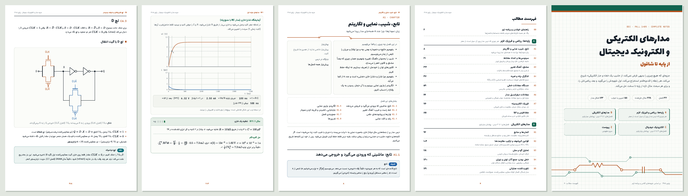

<div dir="rtl">

# جزوه مدارهای الکتریکی و الکترونیک دیجیتال

**پاییز ۱۴۰۵ · از پایه تا شاقول**

<p>
<a href="https://ahy8507.github.io/EEC-Sheet-Fall1405/"></a>
<a href="docs/EEC-Notes-Fall1405.pdf"></a>


</p>



جزوه‌ای کامل و قدم‌به‌قدم برای درس «مدارهای الکتریکی و الکترونیک دیجیتال» که **هیچ چیزی را بدیهی فرض نمی‌کند**. از «شیب یک خط» و «بار الکتریکی» شروع می‌کند، هر رابطه را خط‌به‌خط استخراج می‌کند و **اول شهود را می‌گوید، بعد ریاضی را**. برای هر مبحث هم مثال‌های تازه از پایه تا چالشی حل می‌کند.

<table>
<tr>
<td align="center"><a href="https://ahy8507.github.io/EEC-Sheet-Fall1405/"><b>📖 خواندن آنلاین</b></a><br><sub>سایت با جستجو، حالت تیره و ابزار تعاملی</sub></td>
<td align="center"><a href="docs/EEC-Notes-Fall1405.pdf"><b>📄 دانلود PDF</b></a><br><sub>A4، ۳۴۴ صفحه، برای چاپ و مطالعه آفلاین</sub></td>
</tr>
</table>

---

## ویژگی‌ها

- **شهود قبل از فرمول.** هر مفهوم اول با یک تصویر ذهنی توضیح داده می‌شود و بعد به معادله می‌رسد. هدف فهمیدن است، نه حفظ کردن.
- **اثبات بدون پرش.** هر رابطه کلیدی در یک جعبه «اثبات قدم‌به‌قدم» استخراج شده است: یک قدم در هر خط و بدون جمله «به‌راحتی دیده می‌شود».
- **پایه‌ها از صفر.** بخش A ریاضی (تابع، مختلط، مشتق، انتگرال، دستگاه معادلات، معادله دیفرانسیل) و فیزیک (الکتریسیته، مغناطیس) لازم را دقیقاً به اندازه‌ای که درس می‌خواهد می‌سازد.
- **۲۲۸ مثال حل‌شده** با چهار سطح پایه، متوسط، سخت و چالشی، و **۱۵۱ تمرین با جواب و راهنمایی**.
- **۱۲۳ شکل مدار** برداری، ده‌ها نمودار و **۷ ابزار تعاملی** در سایت: شیب و مماس، مساحت زیر نمودار، بردار چرخان، شارژ RC، چهار حالت RLC، منحنی انتقال CMOS و مبدل SAR.
- **منطبق با برنامه ترم.** جلسه‌ها، کوییزها و پوشش میان‌ترم و پایان‌ترم به فصل‌های جزوه نگاشت شده‌اند.
- **پیوست مرور.** نقشه مفهومی همه روابط (هر کدام با یک جمله «چرا»)، دام‌های رایج و نقشه مرور هر کوییز.

## راهنمای رنگ‌ها

| جعبه | یعنی چه |
|---|---|
| 🟦 **تعریف** | معنی دقیق یک کلمه؛ همه‌چیز بعداً روی همین ساخته می‌شود. |
| 🟨 **شهود** | تصویر ذهنی: چرا این رابطه منطقی است، بدون فرمول. |
| 🟪 **اثبات قدم‌به‌قدم** | استخراج رابطه، یک قدم در هر خط. |
| 🟧 **نتیجه کلیدی** | چیزی که باید بفهمید (نه حفظ کنید) و همه‌جا به کار می‌آید. |
| 🟥 **دام رایج** | اشتباهی که بیشتر دانشجوها در امتحان می‌کنند. |
| 🟩 **مثال** | با نوار سطح: ▮ پایه، ▮▮ متوسط، ▮▮▮ سخت، ▮▮▮▮ چالشی. |
| 🟫 **تمرین** | اول خودتان حل کنید، بعد جواب را باز کنید. |
| 🔷 **فیزیکش چیست؟** | آنچه واقعاً درون قطعه اتفاق می‌افتد. |

## فهرست فصل‌ها

میان‌ترم فصل‌های ۱ تا ۳ درس (بخش B) و پایان‌ترم فصل‌های ۴ تا ۶ درس (بخش C) را می‌پوشاند. اگر پایه ریاضی‌تان لرزان است، قبل از بخش B فصل‌های بخش A را بخوانید. هر فصل در ابتدایش پیش‌نیازهایش را با لینک نوشته است.

### A · پایه‌ها: ریاضی و فیزیکِ لازم

| کد | فصل | چه چیزی یاد می‌گیریم | جایگاه در درس |
|:-:|---|---|---|
| A1 | [تابع، شیب، نمایی و لگاریتم](https://ahy8507.github.io/EEC-Sheet-Fall1405/#math-functions) | زبان نمودارها؛ چرا عدد e همه‌جای مدار پیدا می‌شود | پیش‌نیاز همه فصل‌ها |
| A2 | [سینوسی‌ها و اعداد مختلط](https://ahy8507.github.io/EEC-Sheet-Fall1405/#math-trig-complex) | دامنه، فرکانس، فاز؛ بردار چرخان و فرمول اویلر | پیش‌نیاز مرتبه دوم و لاپلاس |
| A3 | [مشتق: آهنگ تغییر](https://ahy8507.github.io/EEC-Sheet-Fall1405/#math-derivative) | از شیب وتر تا مشتق؛ همه قاعده‌ها با اثبات | پیش‌نیاز خازن و سلف |
| A4 | [انتگرال، پله و ضربه](https://ahy8507.github.io/EEC-Sheet-Fall1405/#math-integral) | جمع تکه‌های کوچک؛ مساحت؛ قضیه اساسی؛ u(t) و δ(t) | پیش‌نیاز خازن و سلف |
| A5 | [دستگاه معادلات خطی](https://ahy8507.github.io/EEC-Sheet-Fall1405/#math-linear) | حذف، جایگذاری، کرامر و نوشتن ماتریسی | پیش‌نیاز تحلیل گره و مش |
| A6 | [معادلات دیفرانسیل مدار](https://ahy8507.github.io/EEC-Sheet-Fall1405/#math-ode) | مرتبه اول و دوم؛ معادله مشخصه؛ جواب همگن و خصوصی | پیش‌نیاز مدارهای مرتبه اول و دوم |
| A7 | [فیزیک الکتریسیته](https://ahy8507.github.io/EEC-Sheet-Fall1405/#phys-electric) | بار، میدان، ولتاژ، جریان، مقاومت و خازن فیزیکی | پیش‌نیاز فصل ۱ و ۲ درس |
| A8 | [مغناطیس و القا](https://ahy8507.github.io/EEC-Sheet-Fall1405/#phys-magnetic) | شار، قانون فارادی، لنز و سلف فیزیکی | پیش‌نیاز سلف |

### B · مدارهای الکتریکی (میان‌ترم)

| کد | فصل | چه چیزی یاد می‌گیریم | جایگاه در درس |
|:-:|---|---|---|
| B1 | [المان‌ها و منابع](https://ahy8507.github.io/EEC-Sheet-Fall1405/#elements) | کمیت‌های پایه، مقاومت، خطی بودن، منابع مستقل و وابسته | فصل ۱ · کوییز I |
| B2 | [قوانین کیرشهف و ترکیب مقاومت‌ها](https://ahy8507.github.io/EEC-Sheet-Fall1405/#kirchhoff) | KCL، KVL، سری و موازی، تقسیم ولتاژ و جریان، تبدیل منبع، ستاره-مثلث | فصل ۱ · کوییز I |
| B3 | [تحلیل گره و مش](https://ahy8507.github.io/EEC-Sheet-Fall1405/#nodal-mesh) | ابرگره، ابرمش، منابع وابسته و روش بازرسی | فصل ۱ · کوییز I |
| B4 | [خطی بودن، جمع آثار، تونن و نورتن](https://ahy8507.github.io/EEC-Sheet-Fall1405/#thevenin) | همگنی، برهم‌نهی، مدار معادل و انتقال حداکثر توان | فصل ۱ · کوییز I و II |
| B5 | [تقویت‌کننده عملیاتی](https://ahy8507.github.io/EEC-Sheet-Fall1405/#opamp) | مدل ایده‌آل، اتصال کوتاه مجازی، معکوس‌کننده، جمع‌کننده، تفاضلی | از جزوه کلاس |
| B6 | [خازن](https://ahy8507.github.io/EEC-Sheet-Fall1405/#capacitor) | رابطه جریان و ولتاژ، پیوستگی ولتاژ، انرژی، سری و موازی، اتصال خازن‌های باردار | فصل ۲ · کوییز III |
| B7 | [سلف و دوگانی](https://ahy8507.github.io/EEC-Sheet-Fall1405/#inductor) | رابطه ولتاژ و جریان، پیوستگی جریان، انرژی، ترکیب سلف‌ها، مدار دوگان | فصل ۲ · کوییز III |
| B8 | [شکل موج‌ها](https://ahy8507.github.io/EEC-Sheet-Fall1405/#waveforms) | پله، شیب، ضربه، پالس، نمایی و سینوسی؛ ساختن موج از قطعه‌ها | فصل ۲ · کوییز III |
| B9 | [حالت دائمی DC و لحظه کلیدزنی](https://ahy8507.github.io/EEC-Sheet-Fall1405/#switching) | مقادیر 0⁻ و 0⁺ و ∞ و مشتق‌های اولیه | فصل ۲ · کوییز III |
| B10 | [مرتبه مدار](https://ahy8507.github.io/EEC-Sheet-Fall1405/#order) | حلقه خازنی، کات‌ست سلفی و روش سریع شمارش | فصل ۲ · کوییز III |
| B11 | [مدارهای مرتبه اول](https://ahy8507.github.io/EEC-Sheet-Fall1405/#first-order) | ورودی صفر، حالت صفر، فرمول طلایی، پاسخ پله و ضربه، انتگرال‌گیر | فصل ۲ · کوییز III |
| B12 | [مدارهای مرتبه دوم (RLC)](https://ahy8507.github.io/EEC-Sheet-Fall1405/#second-order) | معادله مشخصه، چهار نوع پاسخ، جواب خصوصی، ضربه | فصل ۲ · کوییز III |
| B13 | [پاسخ ضربه از روی معادله دیفرانسیل](https://ahy8507.github.io/EEC-Sheet-Fall1405/#impulse) | تطبیق ضرایب ضربه، رابطه پاسخ پله و ضربه | فصل ۲ |
| B14 | [کانولوشن و تبدیل لاپلاس](https://ahy8507.github.io/EEC-Sheet-Fall1405/#laplace) | پاسخ به ورودی دلخواه، جدول تبدیل‌ها، قضایا، کسرهای جزئی | فصل ۳ · کوییز IV |
| B15 | [امپدانس، ادمیتانس و تحلیل در حوزه s](https://ahy8507.github.io/EEC-Sheet-Fall1405/#s-domain) | مدل المان‌ها با شرط اولیه، تابع شبکه، قطب و صفر، پایداری، حالت دائمی سینوسی | فصل ۳ · کوییز IV |

### C · الکترونیک دیجیتال (پایان‌ترم)

| کد | فصل | چه چیزی یاد می‌گیریم | جایگاه در درس |
|:-:|---|---|---|
| C1 | [دیود](https://ahy8507.github.io/EEC-Sheet-Fall1405/#diode) | نیمه‌هادی، پیوند p-n، مشخصه نمایی، مدل‌ها، یکسوساز، برش‌دهنده و زنر | فصل ۴ · کوییز V |
| C2 | [ترانزیستور ماسفت افزایشی](https://ahy8507.github.io/EEC-Sheet-Fall1405/#mosfet) | ساختار، تشکیل کانال، نواحی کاری، مدل مداری و تحلیل DC | فصل ۴ · کوییز V |
| C3 | [وارونسازها و CMOS](https://ahy8507.github.io/EEC-Sheet-Fall1405/#inverter) | بار مقاومتی و ترانزیستوری، CMOS، منحنی انتقال، حاشیه نویز، تأخیر و توان | فصل ۵ · کوییز V |
| C4 | [ترانزیستور گذر و دروازه انتقال](https://ahy8507.github.io/EEC-Sheet-Fall1405/#pass-tg) | عبور ۰ و ۱، افت آستانه، گیت انتقال و طراحی منطق با آن | فصل ۵ · کوییز V |
| C5 | [منطق CMOS ایستا و پویا](https://ahy8507.github.io/EEC-Sheet-Fall1405/#cmos-logic) | شبکه بالاکش و پایین‌کش، دوگانی، گیت پیچیده، اندازه‌گذاری، منطق دینامیک و دومینو | فصل ۵ · کوییز VI |
| C6 | [لچ، فلیپ‌فلاپ و شیفت رجیستر](https://ahy8507.github.io/EEC-Sheet-Fall1405/#latch-ff) | لچ SR و D، معکوس‌کننده کلاک‌دار، Master–Slave، شیفت رجیستر دینامیک | فصل ۶ · کوییز VI |
| C7 | [حافظه‌های RAM و ROM](https://ahy8507.github.io/EEC-Sheet-Fall1405/#memory) | آرایه، رمزگشا، PROM، EPROM، Flash، DRAM و SRAM | فصل ۶ · کوییز VI |
| C8 | [نوسان‌ساز و مبدل‌های داده](https://ahy8507.github.io/EEC-Sheet-Fall1405/#converters) | نوسان‌ساز RC، مبدل D/A وزن‌دار و R-2R، مبدل‌های A/D | از جزوه کلاس |

### Z · پیوست

| کد | فصل | چه چیزی یاد می‌گیریم | جایگاه در درس |
|:-:|---|---|---|
| Z1 | [نقشه مفهومی و جمع‌بندی روابط](https://ahy8507.github.io/EEC-Sheet-Fall1405/#summary) | هر رابطه با یک جمله «چرا»؛ برای مرور شب امتحان | مرور کل درس |

<details>
<summary><b>برنامه ترم: هر جلسه در کدام فصل جزوه است؟</b></summary>

<br>

| جلسه | مبحث | فصل جزوه | کوییز |
|---|---|---|:-:|
| مهر ۵ | المان‌های الکتریکی، قانون ولتاژ و جریان کیرشهف | [B1](https://ahy8507.github.io/EEC-Sheet-Fall1405/#elements)، [B2](https://ahy8507.github.io/EEC-Sheet-Fall1405/#kirchhoff) | Quiz I |
| مهر ۷ | تحلیل مدار، اتصالات سری و موازی المان‌های مقاومتی | [B2](https://ahy8507.github.io/EEC-Sheet-Fall1405/#kirchhoff) | Quiz I |
| مهر ۱۲ | روش‌های تحلیل مدار: آنالیز گره و مش | [B3](https://ahy8507.github.io/EEC-Sheet-Fall1405/#nodal-mesh) | Quiz I |
| مهر ۱۴ | خطی بودن و اصل برهم‌نهی | [B4](https://ahy8507.github.io/EEC-Sheet-Fall1405/#thevenin) | Quiz I |
| مهر ۱۹ تا ۲۶ | مدارهای معادل تونن و نورتن | [B4](https://ahy8507.github.io/EEC-Sheet-Fall1405/#thevenin) | Quiz II |
| مهر ۲۸ | معرفی عناصر ذخیره‌کننده انرژی | [B6](https://ahy8507.github.io/EEC-Sheet-Fall1405/#capacitor)، [B7](https://ahy8507.github.io/EEC-Sheet-Fall1405/#inductor) | Quiz III |
| آبان ۳ | شکل موج‌ها و مدارهای مرتبه اول | [B8](https://ahy8507.github.io/EEC-Sheet-Fall1405/#waveforms)، [B9](https://ahy8507.github.io/EEC-Sheet-Fall1405/#switching)، [B10](https://ahy8507.github.io/EEC-Sheet-Fall1405/#order)، [B11](https://ahy8507.github.io/EEC-Sheet-Fall1405/#first-order) | Quiz III |
| آبان ۱۰ | مدارهای مرتبه اول | [B11](https://ahy8507.github.io/EEC-Sheet-Fall1405/#first-order) | Quiz III |
| آبان ۱۲ و ۱۷ | مدارهای مرتبه دوم | [B12](https://ahy8507.github.io/EEC-Sheet-Fall1405/#second-order)، [B13](https://ahy8507.github.io/EEC-Sheet-Fall1405/#impulse) | Quiz III |
| آبان ۱۹ | امپدانس و ادمیتانس | [B15](https://ahy8507.github.io/EEC-Sheet-Fall1405/#s-domain) | Quiz IV |
| آبان ۲۴ تا آذر ۱ | آنالیز مدار با تبدیل لاپلاس | [B14](https://ahy8507.github.io/EEC-Sheet-Fall1405/#laplace)، [B15](https://ahy8507.github.io/EEC-Sheet-Fall1405/#s-domain) | Quiz IV |
| آذر ۳ و ۸ | منحنی مشخصه، مدل و کاربردهای دیود | [C1](https://ahy8507.github.io/EEC-Sheet-Fall1405/#diode) | Quiz V |
| آذر ۱۰ و ۱۵ | ساختار، عملکرد و منحنی مشخصه ماسفت افزایشی | [C2](https://ahy8507.github.io/EEC-Sheet-Fall1405/#mosfet) | Quiz V |
| آذر ۱۷ | انواع مدارهای وارونساز با ترانزیستور | [C3](https://ahy8507.github.io/EEC-Sheet-Fall1405/#inverter) | Quiz V |
| آذر ۲۲ و ۲۴ | ترانزیستور گذر و دروازه انتقال | [C4](https://ahy8507.github.io/EEC-Sheet-Fall1405/#pass-tg) | Quiz V |
| آذر ۲۹ | منطق CMOS ایستا | [C5](https://ahy8507.github.io/EEC-Sheet-Fall1405/#cmos-logic) | Quiz VI |
| دی ۱ و ۶ | Latch و FF، شیفت رجیستر | [C6](https://ahy8507.github.io/EEC-Sheet-Fall1405/#latch-ff) | Quiz VI |
| دی ۸ | انواع حافظه‌های RAM و ROM | [C7](https://ahy8507.github.io/EEC-Sheet-Fall1405/#memory) | Quiz VI |

نمره از ۲۰: میان‌ترم ۵، پایان‌ترم ۷، کوییزها ۴ و تمرین‌ها ۴.

</details>

## نسخه PDF

فایل [`docs/EEC-Notes-Fall1405.pdf`](docs/EEC-Notes-Fall1405.pdf) همان محتوای سایت است که برای کاغذ A4 صفحه‌آرایی شده است:

- جلد، صفحه راهنما و برنامه ترم، و **فهرست مطالب با شماره صفحه** که روی هر سطرش می‌شود کلیک کرد
- یک صفحه جدا برای شروع هر بخش، و **سرصفحه‌ای با نام فصل** در همه صفحه‌ها
- **نشانک (bookmark) برای هر فصل و هر بخش** در کنار صفحه نمایشگر PDF
- لینک‌های داخلی (پیش‌نیازها و فهرست هر فصل) در خود PDF هم کار می‌کنند
- جواب همه تمرین‌ها باز است و ابزارهای تعاملی با حالت پیش‌فرضشان چاپ شده‌اند

## مشاهده و راه‌اندازی سایت

سایت یک صفحه HTML مستقل است: [`docs/index.html`](docs/index.html). کافی است آن را در مرورگر باز کنید. برای فرمول‌ها اینترنت لازم است، چون MathJax از CDN بارگذاری می‌شود.

**فعال کردن GitHub Pages**

1. در گیت‌هاب به **Settings ← Pages** بروید.
2. در **Build and deployment**، گزینه **Source** را روی **Deploy from a branch** بگذارید.
3. شاخه‌ای را که این فایل‌ها در آن است (مثلاً `main`) و پوشه `/docs` را انتخاب و **Save** کنید.
4. یکی دو دقیقه بعد سایت در `https://ahy8507.github.io/EEC-Sheet-Fall1405/` بالا می‌آید و PDF در `https://ahy8507.github.io/EEC-Sheet-Fall1405/EEC-Notes-Fall1405.pdf` در دسترس است.

در حساب رایگان گیت‌هاب، Pages فقط برای مخزن عمومی کار می‌کند.

## ساختن دوباره از سورس

**سایت** (پایتون ۳ و [schemdraw](https://schemdraw.readthedocs.io/) برای رسم مدارها):

```bash
pip install schemdraw
```

```bash
python3 build.py
```

خروجی در `docs/index.html` نوشته می‌شود.

**PDF** (علاوه بر موارد بالا: Node.js، Playwright با Chromium، و pypdf برای نشانک‌ها):

```bash
pip install pypdf
```

```bash
npm install
```

```bash
npx playwright install chromium
```

```bash
python3 build.py --pdf
```

اسکریپت نسخه چاپی را دو بار چاپ می‌کند: بار اول شماره صفحه هر فصل را پیدا می‌کند و بار دوم آن شماره‌ها را در فهرست می‌نویسد. بعد نشانک‌ها را اضافه می‌کند و خروجی را در `docs/EEC-Notes-Fall1405.pdf` می‌نویسد.

## ساختار پروژه

<div dir="ltr">

```
build.py                 builds docs/index.html and the PDF edition
src/chapters/*.html      chapter text (shorthand tags: <def>, <prf>, <ex>, <hw>, <eq>, <fig>, <plot> ...)
src/circuits/*.py        circuit drawings (schemdraw), registered by name
src/style.css            site design (light and dark themes)
src/print.css            extra layout for the A4 PDF edition
src/app.js               router, search, MathJax loader, plots and interactive widgets
tools/render_pdf.js      prints the PDF edition with headless Chromium
docs/                    the published site (index.html), the PDF and images
```

</div>

## منبع

محتوا بر اساس جزوه‌های کلاس که در همین مخزن هستند و برنامه رسمی ترم پاییز ۱۴۰۵ بازنویسی و کامل شده است:

- [جزوه مدارهای الکتریکی و الکترونیک دیجیتال](%D8%AC%D8%B2%D9%88%D9%87_%D9%85%D8%AF%D8%A7%D8%B1%D9%87%D8%A7%DB%8C_%D8%A7%D9%84%DA%A9%D8%AA%D8%B1%DB%8C%DA%A9%DB%8C_%D9%88_%D8%A7%D9%84%DA%A9%D8%AA%D8%B1%D9%88%D9%86%DB%8C%DA%A9_%D8%AF%DB%8C%D8%AC%DB%8C%D8%AA%D8%A7%D9%84.pdf)
- [جزوه خازن، سلف و مرتبه مدار](%D8%AC%D8%B2%D9%88%D9%87_%D8%AE%D8%A7%D8%B2%D9%86_%D8%B3%D9%84%D9%81_%D9%88_%D9%85%D8%B1%D8%AA%D8%A8%D9%87_%D9%85%D8%AF%D8%A7%D8%B1.pdf)

مثال‌ها و تمرین‌ها تازه‌اند و همه حل‌ها قدم‌به‌قدم بازبینی شده‌اند. اگر جایی اشتباه دیدید، یک Issue باز کنید.

</div>
